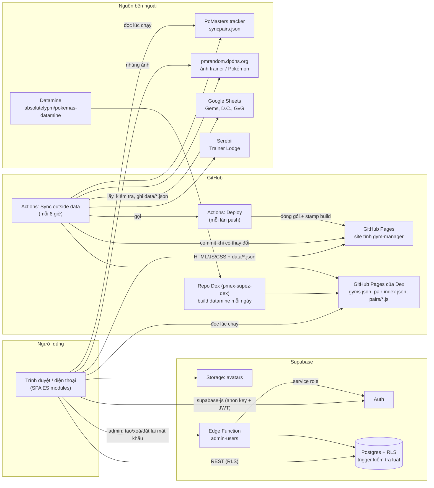
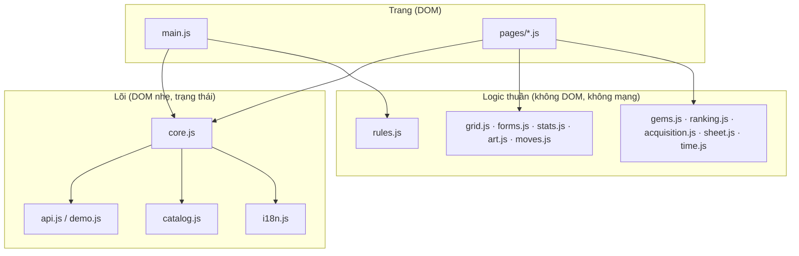
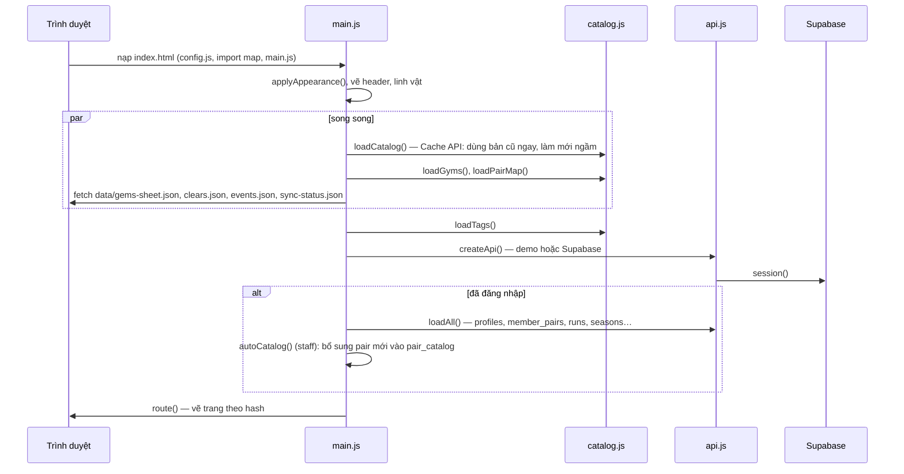
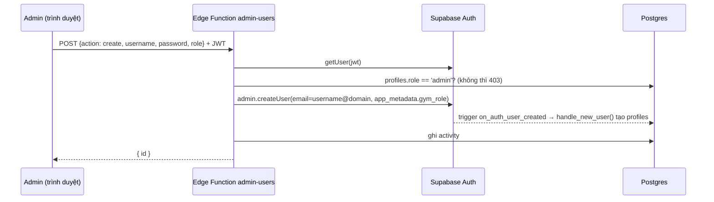
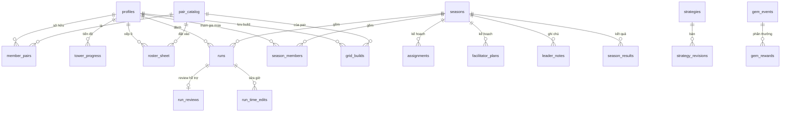
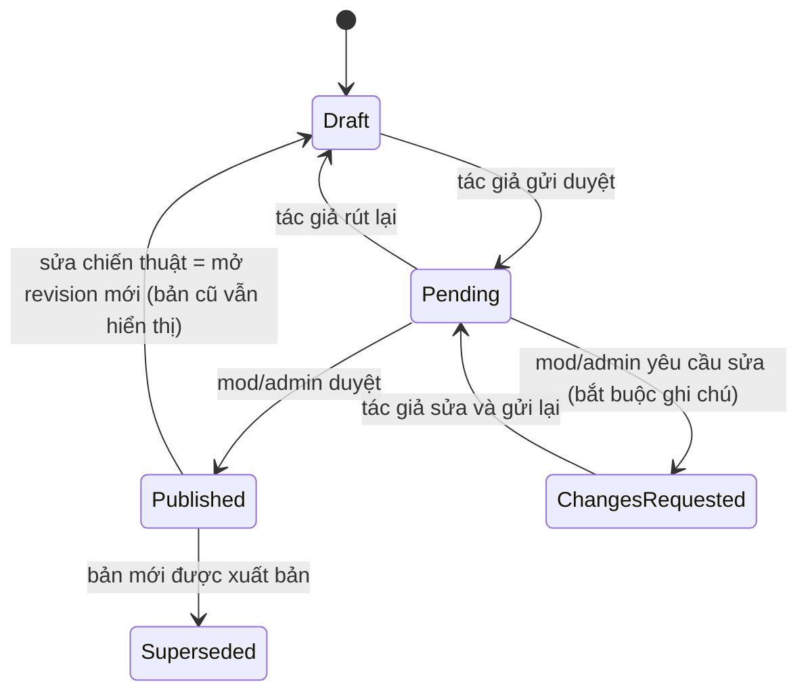
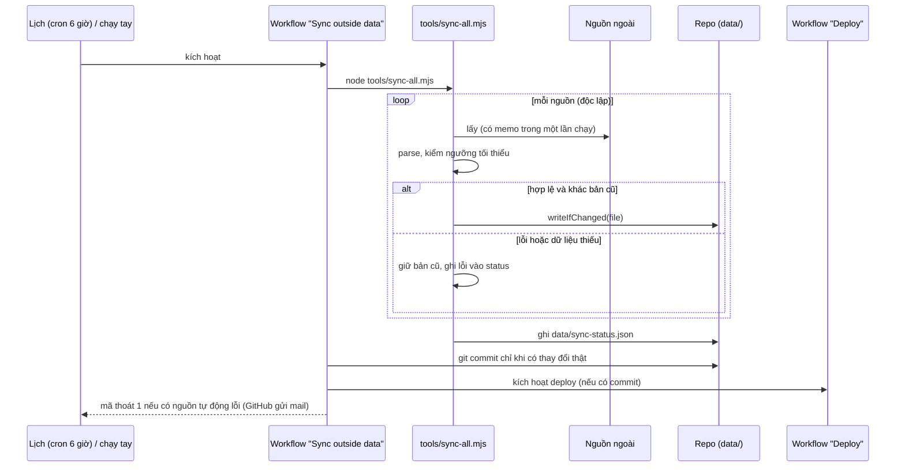
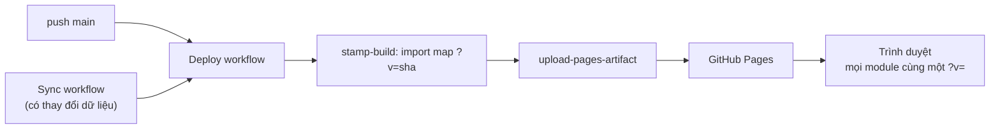

# Kiến trúc hệ thống: PMEX Gym Manager

Cập nhật: 29/10/2026. Tài liệu này mô tả hệ thống **như nó đang chạy**: thành phần, ranh giới trách nhiệm, luồng dữ liệu, mô hình dữ liệu, quyền hạn, quy trình đồng bộ, triển khai, kiểm thử, và những đánh đổi đã chọn. Các tài liệu liên quan: `docs/data-sync.md` (đồng bộ dữ liệu), `docs/v2-status.md` (trạng thái yêu cầu v2.0), `docs/BA-feature-expansion-2026-10-26.md` (tài liệu BA), `README.md` (cách dựng và dùng).

## Mục lục

1. [Mục tiêu, người dùng, ràng buộc](#1-mục-tiêu-người-dùng-ràng-buộc)
2. [Bức tranh tổng thể](#2-bức-tranh-tổng-thể)
3. [Nguyên tắc thiết kế](#3-nguyên-tắc-thiết-kế)
4. [Frontend](#4-frontend)
5. [Lớp truy cập dữ liệu](#5-lớp-truy-cập-dữ-liệu)
6. [Backend (Supabase)](#6-backend-supabase)
7. [Mô hình dữ liệu](#7-mô-hình-dữ-liệu)
8. [Các miền nghiệp vụ](#8-các-miền-nghiệp-vụ)
9. [Dữ liệu từ bên ngoài và đồng bộ tự động](#9-dữ-liệu-từ-bên-ngoài-và-đồng-bộ-tự-động)
10. [Triển khai và cache](#10-triển-khai-và-cache)
11. [Bảo mật](#11-bảo-mật)
12. [Kiểm thử và chất lượng](#12-kiểm-thử-và-chất-lượng)
13. [Vận hành](#13-vận-hành)
14. [Hiệu năng và giới hạn mở rộng](#14-hiệu-năng-và-giới-hạn-mở-rộng)
15. [Các quyết định thiết kế và đánh đổi](#15-các-quyết-định-thiết-kế-và-đánh-đổi)
16. [Hạn chế đã biết và hướng phát triển](#16-hạn-chế-đã-biết-và-hướng-phát-triển)
17. [Phụ lục](#17-phụ-lục)

---

## 1. Mục tiêu, người dùng, ràng buộc

**Là gì.** Ứng dụng quản lý một gym (nhóm chơi) trong Pokémon Masters EX: ghi lại và lên kế hoạch các lượt đánh Gym Battle theo mùa, quản lý roster sync pair của từng thành viên, tiến độ Pasio Tower, thư viện chiến thuật, Sync Grid, lịch Free Gems, Trainer Lodge và kho tài nguyên.

**Người dùng.** Ba vai trò: `admin` (một người, quản lý tài khoản và mùa), `mod` (hỗ trợ vận hành), `member` (thành viên). Quy mô hiện tại khoảng 16 tài khoản thật ở production (tính đến 28/10/2026), vài trăm lượt đánh mỗi mùa. Người dùng chủ yếu dùng **điện thoại**; giao diện có hai ngôn ngữ (English mặc định, Tiếng Việt).

**Ràng buộc quyết định kiến trúc**

| Ràng buộc | Hệ quả |
|---|---|
| Không có ngân sách vận hành, không có người trực | Không tự chạy server riêng; dùng GitHub Pages (tĩnh) và Supabase (gói miễn phí) |
| Dữ liệu game đổi hằng tháng, cộng đồng sửa bảng liên tục | Mọi dữ liệu bên ngoài đi qua quy trình đồng bộ tự động, có kiểm tra an toàn và báo lỗi |
| Tài khoản thật đang dùng | Mọi thay đổi database đi qua migration, có test quyền; không phá dữ liệu cũ |
| Người dùng không kỹ thuật | Mọi lỗi phải hiện thành thông báo dễ hiểu; trang lỗi nguồn ngoài không được làm sập app |
| Một người bảo trì | Ít thành phần, không bước build, không framework; tài liệu và test thay cho trí nhớ |

**Không thuộc phạm vi:** mô phỏng trận đấu, tính sát thương (chờ công thức được kiểm chứng), tier list tự động (nguồn không đọc được bằng máy), ứng dụng native, chạy offline.

---

## 2. Bức tranh tổng thể



Hệ thống có **bốn lớp**, mỗi lớp có một vai trò rõ:

| Lớp | Là gì | Giữ cái gì |
|---|---|---|
| **Trình duyệt** | Một trang SPA viết bằng ES modules thuần, không build | Toàn bộ giao diện và logic hiển thị; kiểm tra luật trước khi gửi lên |
| **Supabase** | Postgres + RLS + trigger, Auth, Storage, một Edge Function | **Nguồn sự thật** cho dữ liệu của gym; thực thi luật và quyền ở phía server |
| **GitHub Pages + Actions** | Hosting tĩnh, quy trình đồng bộ và triển khai | Mã nguồn, các file dữ liệu `data/*.json` đã đồng bộ, trạng thái đồng bộ |
| **Nguồn ngoài** | Tracker, Dex, pmrandom, Google Sheets, Serebii | Dữ liệu game và dữ liệu cộng đồng; app chỉ đọc, không bao giờ ghi |

Điểm mấu chốt: **không có server ứng dụng nào do mình vận hành**. Mọi "logic server" là trigger và hàm trong Postgres cộng một Edge Function nhỏ cho việc cần quyền service role.

---

## 3. Nguyên tắc thiết kế

1. **Database là chủ, trình duyệt là người kiểm tra sớm.** Luật nghiệp vụ (vé, giới hạn điểm, khoá mùa đã kết thúc, EX cần 5★…) được thực thi bằng trigger trong Postgres. Trình duyệt chạy cùng các kiểm tra (`src/rules.js`, `src/grid.js`) chỉ để báo lỗi ngay; không bao giờ tin vào nó.
2. **RLS cho mọi bảng.** Anon key công khai là chủ đích; mọi quyền nằm ở policy theo `auth.uid()` và vai trò.
3. **Không có bước build.** Mã nguồn chạy nguyên trạng trong trình duyệt (ES modules + import map). Hệ quả: dễ đọc, dễ sửa, triển khai là sao chép thư mục; đổi lại phải tự lo cache-busting (xem [10](#10-triển-khai-và-cache)).
4. **Dữ liệu ngoài là "không đáng tin" theo mặc định.** Mỗi nguồn có parser phòng thủ, ngưỡng tối thiểu, và khi lỗi thì **giữ bản cũ** thay vì ghi đè rỗng.
5. **Một nguồn hỏng không kéo theo nguồn khác.** Mỗi nguồn chạy độc lập; trạng thái từng nguồn ghi riêng; workflow báo đỏ để người bảo trì biết.
6. **Một giao diện, hai backend.** `api.js` có bản Supabase và bản demo trong bộ nhớ cho cùng một hợp đồng, nên demo, e2e và phát triển cục bộ không cần database.
7. **Logic thuần tách khỏi DOM.** Mọi luật quan trọng nằm trong module không đụng DOM/mạng (`grid`, `forms`, `gems`, `ranking`, `moves`, `stats`, `art`, `rules`, `time`…) để test bằng Node không cần trình duyệt.
8. **Hiển thị trung thực.** Thiếu dữ liệu thì hiện "không biết" hoặc dùng nguồn dự phòng; không đoán (ví dụ ảnh dạng Pokémon chỉ dùng khi khớp chắc chắn).
9. **Không bí mật trong repo.** Chỉ có anon key (công khai theo thiết kế). Service role key chỉ tồn tại trong môi trường Edge Function và secret của GitHub Actions.

---

## 4. Frontend

### 4.1 Công nghệ và cấu trúc

JavaScript thuần (ES modules), HTML do template string sinh ra, CSS thuần (biến CSS). Không framework, không bundler, không TypeScript. Tổng cộng khoảng 4.000 dòng JS và 1.500 dòng CSS.

```
index.html            khung trang, import map (được stamp lúc deploy), nạp config.js và src/main.js
config.js             cấu hình triển khai: Supabase URL + anon key, tên gym, nguồn dữ liệu
styles.css            toàn bộ CSS: theme, thành phần, trang
src/
  main.js             router, header/menu, các trang cũ (Overview, Log, Plan, Members, Roster, Admin…)
  core.js             trạng thái dùng chung S, helper hiển thị, quyền (isStaff), toast/act, hooks
  api.js              lớp truy cập dữ liệu (Supabase)       demo.js  bản demo trong bộ nhớ
  catalog.js          danh sách sync pair (tracker), Dex, chỉ mục pair, loại hệ/role
  rules.js            luật Gym Battle (circuit, vé, điểm) — bản trình duyệt của check_run()
  grid.js forms.js stats.js art.js moves.js     Sync Grid: luật, dạng, chỉ số, ảnh, văn bản chiêu
  gems.js ranking.js acquisition.js sheet.js    Gems, xếp hạng clear, thứ tự cách nhận, roster sheet
  time.js tracker.js freshness.js               múi giờ, nhập backup tracker, độ mới của nguồn
  i18n.js lang/vi.js  appearance.js icons.js mascot.js     ngôn ngữ, giao diện, icon pixel, linh vật
  pages/              các trang tách riêng: info, resources, strategies, clears, lodge,
                      gridpage, gemspage, gemsextra, freshness
tools/                công cụ đồng bộ và build dữ liệu (Node), chạy trong Actions hoặc tay
test/                 unit test (Node) và e2e (trình duyệt)
supabase/             migrations, edge function, test RLS
data/                 file dữ liệu đã đồng bộ (JSON) và sync-status.json
```

### 4.2 Phân tầng module



Quy ước: **tầng 1 không import tầng trên** và không dùng `window`/`document` (riêng `art.js` đọc `window.GYM_CONFIG` có bảo vệ để chạy được trong Node). Nhờ vậy test unit chạy bằng `node` trần. Các trang tự đăng ký listener khi được import (một `document.addEventListener` ủy quyền sự kiện cho mỗi trang).

### 4.3 Khởi động (boot)



Điểm đáng chú ý:
- Danh sách pair (`syncpairs.json`, khoảng 750 KB) được lưu bằng **Cache API** theo kiểu *stale-while-revalidate*: lần mở thứ hai hiện ngay từ bản đã lưu (khoảng 0,1 giây thay vì 2 giây) và tải bản mới ngầm cho lần sau. Việc ghi cache chạy sau khi đã đọc xong dữ liệu để không chặn trang.
- Nếu bất kỳ bước nào ở khối `try` lỗi, trang hiện thông báo "Could not load" kèm lý do, không để trắng màn hình.

### 4.4 Router và điều hướng

Router theo **hash** (`#/tên-trang/tham-số…`), không cần cấu hình server. `route()` đọc hash, gọi hàm trang tương ứng (trả về HTML), gán vào `#view`, rồi chạy hàm hậu xử lý nếu có. Tên trang không có trong bảng route hiện trang **"Page not found"** thay vì âm thầm mở Overview.

Menu có **hai cấp** (`NAV_GROUPS`): năm nhóm cấp một (Gym Battle, Roster, Battle resources, Game info, Admin) và các trang con của mỗi nhóm. Nhóm cuối cùng người dùng mở được ghi nhớ trong `sessionStorage`.

| Nhóm | Trang |
|---|---|
| Gym Battle | Overview `#/`, Log a run `#/log`, Plan `#/plan`, Battle info `#/info` |
| Roster | Members `#/members`, Roster by type `#/roster`, Sync Grid `#/grid[/id[/buildId]]` |
| Battle resources | Strategies `#/strategies`, Resources `#/resources` |
| Game info | Free Gems `#/gems`, Trainer Lodge `#/lodge` |
| Admin | `#/admin` (chỉ staff) |
| Khác | `#/member/<id>`, `#/settings` |

Trên điện thoại, menu cấp một là **thanh dưới đáy** (đủ icon và chữ); header phía trên mỏng và tự ẩn khi cuộn xuống. Trên tablet menu cấp một nằm hàng riêng. Chiều cao header cố định ở mọi trang để nội dung không nhảy.

### 4.5 Trạng thái và vẽ giao diện

- **Trạng thái toàn cục** là một đối tượng `S` trong `core.js` (người dùng hiện tại, danh sách profile, `member_pairs`, tower, mùa, lượt đánh, assignments…). Sau mỗi thao tác ghi, trang nạp lại phần liên quan rồi vẽ lại.
- **Vẽ lại bằng template string** gán vào `innerHTML`; mọi chuỗi từ dữ liệu đi qua `esc()`. Trang lớn vẽ lại từng vùng (ví dụ bảng Log, bảng bên của Sync Grid) thay vì cả trang.
- **Sự kiện ủy quyền:** mỗi trang đăng ký một vài listener `click`/`change`/`input` ở `document`, đọc `data-*` của phần tử để biết làm gì. Cách này sống sót qua việc vẽ lại `innerHTML`.
- **Trạng thái dẫn xuất của mùa** (vé đã cấp, round đang mở, điểm theo leader/thành viên) tính trong trình duyệt từ danh sách lượt đánh bằng `rules.js` (`seasonState`), cùng công thức với hàm SQL `season_tickets_granted`/`season_active_round`.
- **Khoá ngữ cảnh** (`setLock`): khi vẽ trang của mùa đã kết thúc, các điều khiển dành cho staff biến mất để chỉ admin sửa được.

### 4.6 Ngôn ngữ, giao diện, biểu tượng

- **i18n:** `t('English text', {tham_số})`; chuỗi tiếng Anh vừa là khoá. Thiếu bản dịch thì hiện tiếng Anh. Từ điển tiếng Việt nằm ở `src/lang/vi.js`. Ngôn ngữ lưu ở `localStorage`.
- **Giao diện (theme):** bốn *style* (`switch` mặc định, `ds`, `gameboy`, `studio`) × hai *mode* sáng/tối × màu nhấn, đặt bằng thuộc tính `data-style`, `data-theme`, `data-accent` trên `<html>`. Mọi màu, phông, bo góc, viền, bóng là **biến CSS** nên mỗi style tự có phiên bản của nó. Màu chữ phụ được tính để đạt tương phản tối thiểu 4,5:1 trên cả bốn nền ở mọi theme.
- **Icon:** icon pixel vẽ trên lưới 12×12 (`icons.js`, sinh SVG `rect`), riêng dấu tích là nét vector vì pixel bị nhoè ở cỡ nhỏ. Sprite game lấy từ tracker (icon pair, hệ, role), Dex (sprite leader, trainer pixel) và pmrandom (ảnh 2D/3D).
- **Linh vật** (`mascot.js`): nhân vật nhỏ ở góc, có lời nhắc theo ngữ cảnh (vé còn lại, round đang mở…).

### 4.7 Khả năng truy cập và đáp ứng

Chữ tối thiểu 12px (trừ nhãn trong ô lưới SVG), tương phản AA cho chữ phụ, mọi ô nhập có tên truy cập (một `MutationObserver` gán `aria-label` từ placeholder/tiêu đề cho ô nào còn thiếu), vùng bấm 40px trên cảm ứng, vòng tiêu điểm bàn phím rõ, tôn trọng `prefers-reduced-motion`. Bảng dài (lịch sử lượt đánh) hiển thị 40 dòng một lần.

---

## 5. Lớp truy cập dữ liệu

`src/api.js` xuất `createApi()` và trả về một đối tượng có cùng phương thức cho cả hai backend:

| Backend | Khi nào dùng | Đặc điểm |
|---|---|---|
| **Supabase** | `config.js` có URL và anon key | `supabase-js` nạp từ CDN (jsDelivr, ESM); mọi quyền do RLS quyết định |
| **Demo** | Thiếu cấu hình hoặc có `?demo` | `demo.js`: dữ liệu mẫu sinh bằng bộ sinh số giả ngẫu nhiên cố định, giữ trong bộ nhớ, không lưu gì |

Quy ước chung:
- Mỗi phương thức trả về **hàng thuần** và **ném `Error(message)`** khi lỗi; `act(fn, okMsg)` ở `core.js` bọc lại để hiện toast thành công/thất bại và trả về `true/false`.
- **Phân trang đọc:** Supabase cắt âm thầm ở 1000 hàng mỗi yêu cầu, và một hàng vừa sửa có thể dịch xuống cuối bảng không có thứ tự nên chính hàng đó "biến mất". Mọi danh sách có thể vượt 1000 hàng được đọc theo trang, có `order` cố định (`all()` trong `api.js`).
- **Đăng nhập bằng tên người dùng:** Supabase Auth cần email, nên mỗi tài khoản có email nội bộ `<username>@<usernameDomain>` (không bao giờ gửi thư). Người dùng chỉ thấy tên đăng nhập.
- Demo là **hợp đồng thứ hai**: khi thêm phương thức ở `api.js` phải thêm ở `demo.js`, nếu không e2e sẽ vỡ. Đó là cách giữ hai bản không lệch nhau.

---

## 6. Backend (Supabase)

### 6.1 Xác thực và vai trò



- Vai trò (`gym_role`: `admin | mod | member`) nằm ở `profiles.role` và được **đồng bộ từ `app_metadata.gym_role`** của Auth bằng trigger `sync_role_from_auth`. Người dùng không thể tự nâng quyền: `guard_profile_update` chặn đổi role/username trên hồ sơ của chính mình.
- Hàm `is_staff()` và `is_admin()` (đọc vai trò của `auth.uid()`) là cơ sở của hầu hết policy.
- **Edge Function `admin-users`** là nơi *duy nhất* dùng **service role key**. Hành động: `create`, `delete`, `reset_password`, `set_role`. Chỉ admin gọi được; mọi thao tác ghi vào bảng `activity`.
- Mật khẩu tối thiểu 8 ký tự; tên đăng nhập `[a-z0-9_.-]{3,32}`.

### 6.2 Ma trận quyền (RLS)

| Bảng | Đọc | Ghi |
|---|---|---|
| `profiles` | đã đăng nhập | chính mình hoặc staff (role/username bị chặn bởi trigger) |
| `pair_catalog` | đã đăng nhập | staff |
| `member_pairs` | đã đăng nhập | chính mình hoặc staff |
| `roster_sheet` | đã đăng nhập | chính mình hoặc staff |
| `tower_progress` | đã đăng nhập | chính mình hoặc staff |
| `seasons`, `season_members`, `season_results` | đã đăng nhập | staff |
| `runs` | đã đăng nhập | thêm/sửa/xoá: chính mình hoặc staff (kèm trigger kiểm tra luật, xem 6.3) |
| `assignments`, `facilitator_plans`, `leader_notes` | đã đăng nhập | staff |
| `run_reviews`, `run_time_edits` | staff hoặc chủ lượt đánh | staff (review) / trigger (lịch sử sửa giờ) |
| `strategies`, `strategy_revisions` | tất cả đọc bài; bản nháp/chờ duyệt chỉ tác giả và staff | tác giả sửa bản của mình; staff duyệt, xoá |
| `grid_builds` | của mình hoặc bản chia sẻ với gym | chỉ chủ sở hữu |
| `resource_links` | đã đăng nhập | staff |
| `gem_events`, `gem_rewards`, `gem_settings` | đã đăng nhập | staff |
| `activity` | staff | trigger và Edge Function |
| Storage `avatars` | công khai (đọc) | mỗi người chỉ ghi vào thư mục của mình, hoặc staff |

Chủ ý: nhiều bảng **cho mọi thành viên đọc** (roster, tower, runs của nhau) vì gym là nhóm tin cậy và tính năng cần thấy dữ liệu của nhau; **ghi** thì luôn bị giới hạn.

### 6.3 Bất biến được thực thi bằng trigger

| Trigger / hàm | Bảo đảm |
|---|---|
| `check_run` | leader phải thuộc mùa; round phải tồn tại; circuit cố định số vé (ví dụ vòng thường luôn 3 vé, Extra Battle mới được 1–3); thành viên bị khoá không log được; không vượt số vé đã cấp tới thời điểm đó; gym không vượt trần vé; điểm không vượt phần còn thiếu của circuit; thành viên thường chỉ log được round đang mở |
| `lock_ended_season` | khi mùa đã kết thúc, chỉ admin sửa được `runs`, `assignments`, `leader_notes`, `facilitator_plans` |
| `check_run_time` | `occurred_at` tách khỏi `created_at`; quyền sửa giờ theo vai trò và thời điểm; mọi lần sửa ghi `run_time_edits`; không đổi round hay vé |
| `snapshot_run_main_type` | lưu main type của thành viên *tại thời điểm log* vào `runs.main_type_at` để review lượt hỗ trợ không đổi theo thời gian |
| `check_member_pair` | số sao không dưới sao gốc, level không vượt `max_bonus`, **EX cần 5★**, EX Role chỉ khi pair có |
| `check_roster_sheet`, `check_assignment` | ô roster và đội trong assignment chỉ chứa pair mà thành viên sở hữu; một pair không xuất hiện hai lần trong cùng một đội |
| `drop_pair_from_teams` | xoá pair khỏi roster thì gỡ khỏi đội đã xếp |
| `check_strategy_revision` | luồng trạng thái chiến thuật hợp lệ (xem 8.4): mỗi chiến thuật chỉ có một bản đang viết hoặc đang duyệt; bản đã xuất bản không bao giờ đổi; chỉ tác giả gửi duyệt hoặc rút lại; chỉ mod/admin duyệt; yêu cầu sửa phải có ghi chú |
| `stamp_run_review` | ghi người duyệt và thời điểm |
| `log_activity` | nhật ký thao tác nhạy cảm (lượt đánh, mùa, hồ sơ) |
| `touch_*` | cập nhật `updated_at` |

Các hàm SQL `season_circuit`, `season_tickets_granted`, `season_active_round` là bản SQL của công thức trong `rules.js`; hai bản được giữ khớp nhau và đều có test.

### 6.4 Migration

Mỗi thay đổi schema là một file trong `supabase/migrations/` đặt tên theo thời gian. Danh sách theo thứ tự: nền (`gym_manager`), tách Sub-DPS, gói A v2.0 (vai trò theo mùa, `occurred_at`, múi giờ), `resources`, `strategy_library`, `grid_builds`, `gems`, `support_reviews`. Migration chạy lên production **chỉ khi admin cho phép** (có thể ảnh hưởng dữ liệu thật). Mỗi migration viết để chạy lại được (`if not exists`, `create or replace`).

---

## 7. Mô hình dữ liệu



| Nhóm | Bảng | Ghi chú |
|---|---|---|
| Con người | `profiles` | id (= auth.users), username, display_name, role, avatar, múi giờ IANA |
| Danh mục | `pair_catalog` | bản chụp danh sách pair (id ổn định, hệ, role, EX role, độ hiếm, `max_bonus`); tự bổ sung khi tracker có pair mới |
| Sở hữu | `member_pairs`, `tower_progress`, `roster_sheet` | level, sao, EX, EX Role; tầng Pasio Tower 0–40 theo hệ; ô roster theo hệ và slot |
| Mùa | `seasons`, `season_members`, `season_results` | circuits và leaders lưu JSON; `gym_data` giữ dữ liệu datamine của mùa; thành viên có `battle_role`, `main_type`, `banned` theo mùa |
| Lượt đánh | `runs`, `run_reviews`, `run_time_edits` | `team` là JSON (pair, level, sao, EX); `occurred_at`/`created_at` tách nhau; `main_type_at` chụp thời điểm |
| Kế hoạch | `assignments`, `facilitator_plans`, `leader_notes` | ai đánh leader nào với đội nào; ghi chú chiến lược |
| Chiến thuật | `strategies`, `strategy_revisions` | một chiến thuật nhiều bản; `published_rev` trỏ bản đang xuất bản |
| Sync Grid | `grid_builds` | `nodes` (mảng số thứ tự ô đã bật), `move_level`, `energy_cap`, `grid_hash` (vân tay của grid lúc lưu), `visibility` (`private`/`gym`) |
| Tài nguyên | `resource_links` | link có nhóm, ngôn ngữ, nguồn, phiên bản, trạng thái link |
| Gems | `gem_events`, `gem_rewards`, `gem_settings` | phần thưởng theo ngày/khoảng/một lần, mức chắc chắn |
| Nhật ký | `activity` | ai làm gì, lúc nào |

Nguyên tắc dữ liệu:
- **Thời gian lưu UTC**, hiển thị theo múi giờ IANA của người xem (`time.js`), không bao giờ dùng độ lệch cố định.
- **Id pair là chuỗi ổn định** sinh từ tên (trainer, alt, pokémon, dạng); nếu hai pair trùng tên thì thêm mã nội bộ của Pokémon. Khoá ngoại có `on update cascade`.
- **`grid_builds.nodes` chỉ lưu ô đã bật thật**; ô đang "chờ nối" là trạng thái tạm ở trình duyệt, không lưu.
- **`grid_hash`** cho phép cảnh báo khi game đổi grid của pair sau khi build được lưu.

---

## 8. Các miền nghiệp vụ

### 8.1 Gym Battle (mùa, vé, lượt đánh)

Một **mùa** có các circuit (C1–C3, Extra Battle 1–12 và "…trở đi") với điểm mỗi leader, các leader kèm hệ và điểm yếu, ngày bắt đầu/kết thúc, số vé mỗi ngày và trần vé của thành viên và của gym. Vé được cấp theo thời gian (`season_tickets_granted`).

Một **lượt đánh** gồm thành viên, leader, round, số vé (1–3, có thể cố định theo circuit), điểm, đội 1–3 pair. Quy tắc: không vượt vé đã cấp và trần, điểm tổng của leader trong round không vượt điểm circuit, thành viên bị khoá không log được. Luật chạy hai nơi: `rules.js` trong trình duyệt (báo lỗi ngay) và `check_run()` trong database (quyết định cuối).

Mùa **đã kết thúc bị khoá**: chỉ admin sửa. Thành viên và mod vẫn xem được toàn bộ. Dữ liệu các mùa cũ được nhập từ bảng tính cũ (mùa No. 3 từ file xlsx).

### 8.2 Roster và Sheet

`member_pairs` là kho pair của mỗi người (level 1–5, Superawakened 6–10 nếu pair có, sao 3–5, EX, EX Role). **Roster by type** là một bảng cho mỗi hệ: mỗi hàng một thành viên, các cột theo slot (Special, Sub-DPS Special, Physical, Sub-DPS Physical, EX WTZ, Rebuff, Extend WTZ, Support, Other 1–3) và cột tháp. Slot do người dùng chọn thủ công trong pair mình sở hữu; "gợi ý" (`sheet.js`) chỉ giúp điền, dựa trên thẻ weather/terrain/zone/Type Rebuff của Dex. Nhập được **backup của PoMasters tracker** để đổ toàn bộ roster một lần (`tracker.js`).

### 8.3 Pasio Tower

Một hàng cho mỗi (người, hệ) với tầng 0–40. Ô nhập chỉ nhận chữ số, có nút "40" (xong cả tháp). Mọi thành viên xem được tiến độ của nhau, chỉ chủ hoặc staff sửa. Staff có dashboard (thành viên × hệ, tổng, trung bình, ngày cập nhật) và ảnh PNG cá nhân để lưu hoặc sao chép.

### 8.4 Thư viện chiến thuật



Một chiến thuật có nhiều **bản (revision)** với trạng thái `draft`, `pending`, `published`, `changes_requested`, `superseded`; `published_rev` trỏ bản công khai, nên đang sửa bản mới thì bản cũ vẫn hiển thị. Tại một thời điểm chỉ có một bản đang viết hoặc đang duyệt. Chiến thuật áp vào kế hoạch chỉ với pair thành viên sở hữu. Thư viện **D.C.** và **GvG** (đội clear của cộng đồng) được đọc từ `data/clears.json`, lọc theo cơ chế và hệ, đánh dấu đội mà người xem có thể dựng.

### 8.5 Review lượt hỗ trợ

Mỗi mùa mỗi thành viên có một **battle role** và một **main type**. Lượt đánh được phân loại Main/Support/Unclassified theo main type tại thời điểm log. Staff Confirm hoặc đặt *Needs correction*; review **không đổi điểm, vé, round**.

### 8.6 Free Gems

`gems.js` dự phóng gems đến cuối tháng. Nguồn mặc định là **bảng Gems của cộng đồng** (`data/gems-sheet.json`, kiểm tra tổng khớp bảng); có thể chuyển sang phần thưởng staff tự nhập. Phần thưởng nhận trong cả một khoảng ngày được tách riêng khỏi phần thưởng theo ngày; số tiền chưa biết nằm ở mục "chưa đủ dữ liệu". Lịch sự kiện (banner scout) hiển thị trên lịch tháng.

### 8.7 Sync Grid

Đây là phần phức tạp nhất về logic.

**Dữ liệu.** Mỗi pair có một file `data/pairs/<id>.js` trên Dex, nạp bằng thẻ `<script>` gọi `PMEX_PAIR_LOADED(id, data)` (tránh CORS cho file tĩnh). File chứa chiêu, passive, chỉ số theo level, các dạng và **grid** (danh sách ô: toạ độ trục `q, r, s`, năng lượng, orbs, yêu cầu, màu loại, tên). `dexIdOf(pair)` ánh xạ pair của tracker sang id file Dex qua `pair-index.json` (đọc trực tiếp từ Dex) hoặc `data/pair-map.json` (bản dự phòng). Hai bên viết tên hơi khác nhau ("Leon (Alt)" và "leon (alt.)", dấu nháy, khoảng trắng, trang phục chỉ ghi một phía), nên `pairmap.js` khớp theo bốn bước từ nghiêm ngặt tới thoáng: tên đúng, nhân vật người chơi ("Player" của tracker là "Scottie" của Dex), tên đã chuẩn hoá, và cùng trainer + Pokémon khi chỉ có một pair ở **cả hai phía**. Có hai ứng viên thì không chọn ai.

**Hình học.** Game vẽ lục giác **nằm ngang (flat-top)**: có ô nằm thẳng trên và thẳng dưới tâm. Công thức đặt ô: `x = 1,5·size·q`, `y = −√3·size·(r + q/2)`. Hướng này được xác định bằng cách đối chiếu ảnh chụp lưới thật của game với toàn bộ lưới trong dữ liệu (chỉ một lưới trùng, và 11/11 ô vòng ba khớp). Sáu ô quanh tâm theo thứ tự trong datamine chạy theo chiều kim đồng hồ từ góc 1 giờ.

**Luật bật ô (`grid.js`).**

| Hàm | Vai trò |
|---|---|
| `whyNot(ix, active, c, opts)` | Ô `c` bật được ngay không? Trả `null` hoặc lý do: `not-adjacent` (không kề ô trung tâm hay ô đang bật), `move-level` (yêu cầu level cao hơn), `energy` (vượt giới hạn năng lượng) |
| `canRemove` | Gỡ một ô có làm đứt kết nối của các ô khác với tâm không |
| `validate` | Kiểm toàn bộ build đã lưu: ô không tồn tại, mất kết nối, thiếu level, vượt năng lượng |
| `totals` | Tổng năng lượng, orbs, số ô, theo màu |
| `settle` | Chuyển mọi ô *chờ* đã nối được sang *đang bật*, lặp tới khi hết, theo thứ tự đã chọn |
| `linkGap` | Số ô còn phải chọn để nối ô chờ với tâm (đường ngắn nhất, Dijkstra; ô đã chọn tính 0) |

**Chọn trước ("pending").** Bấm một ô xa (chưa nối được) đưa nó vào trạng thái *chờ* (gạch chéo). Khi các ô ở giữa được bật và tạo chuỗi nối tới ô chờ, `settle` bật nó tự động, kéo theo các ô chờ khác nối sau. Ô chờ không tính vào tổng và **không được lưu**. Ô cần level cao hơn mức đã chọn vẫn bị từ chối.

**Các dạng (`forms.js`).** Datamine lưu chiêu/passive của dạng *theo slot* (`null` = như dạng thường). `formViews(d)` gộp thành bộ chiêu **đầy đủ** cho từng dạng: lớp phủ slot, chiêu Tera/Max ở mục riêng, passive Tera, và đánh dấu chiêu bị đổi kèm tên chiêu bị thay. Quy tắc đồng bộ với Dex: Dynamax/Gigantamax thay chiêu bằng Max Move (theo `fromSlot`) và bỏ chiêu sync.

**Ảnh (`art.js`).** Phần đầu trang chi tiết dùng ảnh 2D của trainer (`chara/<internalTrainerName>_1024.png`, bản `_expose` khi thành viên có pair ở dạng EX) và ảnh 3D Pokémon (`pkmn/<internalPokemonName>_256.png`) từ pmrandom. Tên file lấy từ tracker. Ảnh theo dạng chọn từ `data/pkmn-art.json`: Mega khớp theo tên; Tera dùng ảnh pha lê đúng hệ nếu có (số sau mã `7x` là chỉ số hệ Tera); Primal khớp theo tên; Dynamax/Gigantamax dùng ảnh gốc. Chỉ khớp được **chắc chắn** mới dùng ảnh pmrandom. pmrandom là **nguồn chính**. Mỗi ảnh có **chuỗi dự phòng**: pmrandom → **Serebii (chỉ tạm thời, trong lúc pmrandom chưa cập nhật)** → sprite pixel của Dex → icon pair; một ảnh không tải được tự chuyển sang địa chỉ kế tiếp (`onerror`, danh sách trong `data-fb`), và đặt `referrerpolicy="no-referrer"`. Serebii có cùng ảnh trainer 2D và ảnh Pokémon 256px nhưng chỉ được dùng khi pmrandom chưa có ảnh đó; `tools/build-art.mjs` dò (HEAD) pmrandom trước, rồi mới dò Serebii cho phần còn thiếu, và ghi vào `backup` của `data/pkmn-art.json`. Danh sách này **tự thu hẹp** khi pmrandom bổ sung (mỗi lần đồng bộ tính lại từ đầu) (khoá `<dexNumber>|<pokemonNumber>` như tracker). Quy tắc không đoán: trang phục (outfit) không bao giờ bị thay bằng trang phục khác, và dạng Pokémon không gọi được tên chắc chắn thì bỏ qua. Ảnh theo dạng (`formStem`): Mega và Primal khớp **theo tên trong toàn bộ danh mục** (pmrandom có khi để Mega ở số khác, ví dụ Greninja 0725 và Mega Greninja 0658); Tera dùng ảnh pha lê theo chỉ số hệ nếu có; các dạng chỉ phân biệt bằng mã được ghi trong bảng `FORM_CODES` đã đối chiếu với ảnh thật (Deoxys 11 thường, 12 Attack, 13 Defense, 14 Speed; Terapagos 11 thường, 12 Terastal, 13 Stellar; Silvally 12–28 theo hệ); dạng khác chỉ dùng khi Pokémon có đúng một dạng khác cùng tên; dạng nhìn giống dạng gốc dùng ảnh gốc. **Pair shiny** (tên ảnh kết thúc `_rare`) giữ màu shiny ở mọi dạng: chỉ mục đánh dấu ảnh nào có bản shiny; dạng nào pmrandom không có bản shiny thì trả về rỗng để dùng sprite pixel shiny của Dex, không bao giờ dùng màu thường. Nhân vật người chơi ("Player") chưa có ảnh 2D ở nguồn nào nên dùng sprite pixel của Dex.

**Chỉ số kèm build.** Tổng chỉ số = chỉ số theo level + cộng từ các ô Stat đã bật + phần thưởng EX/EX Role. Datamine không có giá trị EX/EX Role, nên người dùng nhập tay (ô "Add EX / EX role bonuses").

### 8.8 Trainer Lodge

Tra cứu tĩnh các chủ đề mỗi pair thích (5/7/10 điểm), dữ liệu `data/lodge.json` từ Serebii. Hiển thị theo trainer hoặc theo vùng (Kanto → Pasio, vùng lấy từ `syncPairRegion` của tracker); trong mỗi cột điểm, câu trả lời gom theo loại và có màu riêng.

### 8.9 Resources, Info, Admin

`resource_links` là kho link do staff quản lý. **Battle info** hiển thị dữ liệu Gym Battle của datamine (HP boss theo circuit, leader, luật, passive, điều kiện, lịch vé, phần thưởng, round kế tiếp) và so sánh với dữ liệu mùa đã lưu để staff cập nhật. **Admin** gồm quản lý mùa, tài khoản, danh mục pair, **Data updates** (trạng thái từng nguồn đồng bộ) và nhật ký.

---

## 9. Dữ liệu từ bên ngoài và đồng bộ tự động

### 9.1 Hai cách dữ liệu ngoài vào app

| Cách | Nguồn | Vào như thế nào | Ưu / nhược |
|---|---|---|---|
| **Đọc trực tiếp lúc chạy** (`live`) | tracker `syncpairs.json`; Dex `gyms.json`, `pair-tags.json`, `pair-index.json`, `pairs/*.js`; ảnh pmrandom | trình duyệt `fetch` | luôn mới nhất; phụ thuộc nguồn sống; đã có cache (catalog) |
| **Chép về repo** (`file`) | Google Sheets (Gems, D.C., GvG), lịch scout, Trainer Lodge, bản đồ pair, danh mục ảnh | workflow ghi `data/*.json` | chịu được nguồn chết; có thể kiểm tra và từ chối dữ liệu xấu |
| **Thủ công** (`manual`) | Tier list (TQ, Spark) | — | nguồn không đọc được bằng máy |

### 9.2 Quy trình đồng bộ



- Mỗi nguồn khai báo trong `tools/sync-all.mjs`: `id`, nhãn, ngày quá hạn, loại (`live`/`file`/`manual`) và hàm chạy. Hiện có: `catalog`, `gyms`, `tags`, `pairindex`, `pairmap`, `gems`, `clears`, `events`, `lodge`, `art`, `tier`.
- `sync-status.json` ghi cho mỗi nguồn: `ok`, `lastOk`, `lastTry`, `changed`, `items`, `note`, `error`, `since`. Trang **Admin → Data updates** đọc file này và tính tình trạng (`ok`, `stale` quá hạn, `failed`, `never`, `manual`).
- **An toàn:** parser của bảng viết tay tìm hàng tiêu đề thay vì dựa vào vị trí ô và từ chối ghi khi tìm được quá ít dữ liệu; bảng Gems kiểm tổng khớp; trang lỗi không ghi đè dữ liệu tốt.
- Bảng `pair_catalog` trong database được cập nhật bởi mod/admin đầu tiên mở app khi tracker có pair mới (`autoCatalog`), hoặc bởi workflow nếu có secret service role.

### 9.3 Bên Dex

Repo `pmex-supez-dex` chạy mỗi ngày: lấy datamine, build `site/data` (gồm `gyms.json`, `pair-tags.json`, `pair-index.json`, `pairs/*.js`), và `scripts/ci-guard.mjs` **chặn** lần build làm giảm số pair, scout, file, tag hoặc làm mất circuit/leader của Gym Battle. Có commit giữ nhịp sau 25 ngày yên ắng để GitHub không tắt lịch chạy. Chi tiết ở `docs/data-sync.md`.

### 9.4 Phụ thuộc bên thứ ba

| Nguồn | Dùng cho | Nếu hỏng thì |
|---|---|---|
| PoMasters tracker | danh sách pair, icon, tên nội bộ | app dùng bản trong Cache API; roster không có pair mới tới khi tracker sống lại |
| Dex | Gym Battle, grid, chiêu, tag | Sync Grid dùng `pair-map.json` dự phòng; Battle info hiện thông báo; dữ liệu mùa đã lưu trong database vẫn dùng được |
| pmrandom.dpdns.org | ảnh trainer 2D và Pokémon 3D | tự chuyển sang Serebii, rồi sprite pixel của Dex; chức năng không ảnh hưởng. Là **hot-link** tới site của bên thứ ba |
| Serebii (ảnh) | ảnh dự phòng cho pair pmrandom chưa có | bỏ qua, dùng sprite pixel của Dex; cũng là hot-link |
| Google Sheets, Serebii | Gems, D.C./GvG, Trainer Lodge | giữ file cũ, báo lỗi trong Data updates |
| jsDelivr | thư viện `supabase-js` | không đăng nhập được thật; demo vẫn chạy |
| Supabase | toàn bộ dữ liệu gym | app hiện lỗi tải; không có chế độ offline |

---

## 10. Triển khai và cache

**Môi trường.** Một production duy nhất: site trên GitHub Pages (`Kietto03/pmex-gym-manager`) và một dự án Supabase. Không có staging; thay vào đó có **demo** (`?demo`) và bộ test đầy đủ chạy cục bộ.

**Triển khai** (`.github/workflows/deploy.yml`): mỗi lần push vào `main` (hoặc được gọi từ workflow đồng bộ), chạy `tools/stamp-build.mjs` rồi tải toàn bộ thư mục lên Pages.

**Vấn đề cache và lời giải.** GitHub Pages cho trình duyệt giữ file 10 phút, mà trang nạp khoảng 15 module. Ngay sau một lần deploy, có thể chạy `main.js` mới với `core.js` cũ và gây lỗi khó hiểu. Giải pháp: `stamp-build.mjs` ghi vào `index.html` một **import map** ánh xạ mỗi module sang `./src/x.js?v=<mã commit>` và gắn `?v=` cho `styles.css`, `config.js`, `main.js`. Mỗi lần deploy mọi địa chỉ đổi, nên trình duyệt không bao giờ trộn bản cũ với bản mới. Chạy cục bộ không cần stamp.



**Cache phía trình duyệt (tóm tắt):** import map với `?v=` cho mã nguồn; Cache API cho `syncpairs.json`; `localStorage` cho ngôn ngữ, mùa đang xem, mức zoom lưới, linh vật đã chào; `sessionStorage` cho nhóm menu cuối. Mọi truy cập vào storage bọc `try/catch` vì chế độ riêng tư có thể chặn.

**Cấu hình** nằm ở `config.js` (URL Supabase và anon key công khai, tên gym, miền email nội bộ, địa chỉ nguồn dữ liệu). `?dex=<url>` ghi đè địa chỉ Dex để thử cục bộ.

---

## 11. Bảo mật

| Mối đe doạ | Biện pháp |
|---|---|
| Lộ khoá | Chỉ anon key (công khai theo thiết kế) trong repo. Service role key chỉ ở Edge Function và secret của Actions |
| Truy cập dữ liệu trái phép | RLS bật ở mọi bảng; policy theo `auth.uid()` và vai trò; không có đường đọc ghi nào ngoài REST đã qua RLS |
| Tự nâng quyền | `guard_profile_update` chặn đổi role/username; vai trò gốc ở `app_metadata` (không do người dùng sửa được) |
| Quản lý tài khoản | Chỉ qua Edge Function, kiểm tra admin phía server, ghi nhật ký |
| XSS | Mọi dữ liệu chèn vào HTML qua `esc()`; không dùng `eval`; liên kết ngoài có `rel="noopener noreferrer"` |
| Rò thông tin qua ảnh ngoài | Ảnh hot-link đặt `referrerpolicy="no-referrer"` |
| Vi phạm luật bằng gọi API trực tiếp | Trigger trong database kiểm tra lại mọi luật; trình duyệt không phải ranh giới tin cậy |
| Mất dữ liệu do nguồn ngoài hỏng | Giữ bản cũ, ngưỡng tối thiểu, chặn build giảm dữ liệu bên Dex |
| Sao lưu | Dùng sao lưu của Supabase theo gói đang dùng; repo này **chưa** có quy trình xuất sao lưu riêng (xem mục 16) |

Hiện **chưa** có Content-Security-Policy (GitHub Pages không đặt header tuỳ ý; có thể thêm thẻ `<meta>` về sau). Mật khẩu do admin tạo và đặt lại; chưa có tự đặt lại bằng email vì tài khoản không có email thật.

---

## 12. Kiểm thử và chất lượng

| Loại | Lệnh | Phạm vi | Môi trường |
|---|---|---|---|
| **Unit (Node)** | `npm run test:unit` | luật grid (kể cả chọn trước), dạng pair, ảnh, chỉ số, gems, ranking, parser đồng bộ (gems, clears, lodge, art), `sync-lib` (trạng thái/nguồn), chiêu, thứ tự cách nhận | không cần mạng hay trình duyệt |
| **Database** | `npm run test:db` | schema, RLS, các trigger (Postgres 16 trong Docker, có stub `auth`) | cần Docker |
| **E2E (trình duyệt)** | mở `test/e2e.html?demo` (Chrome headless trong CI cục bộ) | hơn 180 bước đi qua giao diện thật ở chế độ demo: đăng nhập, log lượt đánh, roster, tháp, grid, gems, chiến thuật… | Chrome; một số bước dùng nguồn ngoài thật (tracker, pmrandom) |
| **Lint** | ESLint (`no-undef`) trên `src/` | biến chưa khai báo, lỗi cú pháp | chạy cục bộ trước mỗi lần commit; cấu hình chưa nằm trong repo |
| **Kiểm tra truy cập** | kịch bản puppeteer quét mọi trang | tên truy cập, nhãn ô nhập, cỡ chữ, tương phản, vùng bấm, tràn ngang | cục bộ |

Nguyên tắc: logic mới đi kèm test thuần trước; thay đổi giao diện đi kèm bước e2e; thay đổi database đi kèm test RLS. Lưu ý về e2e: dữ liệu demo sinh theo kích thước danh mục nên test không được giả định giá trị cụ thể; bước dùng mạng có thể chập chờn (đã sửa các điểm yếu đã biết).

---

## 13. Vận hành

**Hằng ngày:** không cần làm gì. Đồng bộ chạy mỗi 6 giờ (gym-manager) và hằng ngày (Dex). Xem **Admin → Data updates** để biết nguồn nào quá hạn hoặc lỗi.

**Các tình huống thường gặp**

| Tình huống | Xử lý |
|---|---|
| Workflow đồng bộ đỏ | Mở log; xem nguồn nào lỗi; thường do bảng cộng đồng đổi bố cục → sửa parser trong `tools/` và chạy lại. Trong lúc đó app vẫn dùng bản cũ |
| Game ra pair mới nhưng roster chưa có | Tracker chưa cập nhật; chờ cộng đồng. Sync Grid có thể có sớm hơn (đọc từ Dex) |
| Khách thấy bản cũ sau deploy | Tải lại trang; nếu vẫn cũ, kiểm tra deploy đã xanh. Danh sách pair có thể hiện bản đã lưu ở lần mở đầu |
| Cần thêm bảng hoặc cột | Viết migration mới trong `supabase/migrations/`, thêm test RLS, chạy `test:db`, rồi chạy lên production khi admin đồng ý; cập nhật `demo.js` nếu có thêm phương thức API |
| Thêm nguồn dữ liệu mới | Viết hàm `build…` trong `tools/`, đăng ký ở `sync-all.mjs` (`fileSource` hoặc `liveSource`), thêm test parser; nguồn tự xuất hiện trong Data updates |
| Thêm ngôn ngữ | Thêm file trong `src/lang/` và đăng ký trong `i18n.js` |
| Tài khoản mới, đặt lại mật khẩu | Admin → Accounts (gọi Edge Function) |

**Chạy cục bộ:** `python3 -m http.server 8767` rồi mở `http://localhost:8767/?demo`. Chạy đồng bộ tay: `npm run sync` hoặc `node tools/sync-all.mjs --only <id>[,<id>] [--dry]`.

**Quyền cần thiết một lần:** hai repo (gym manager và Dex) phải để *Workflow permissions* = Read and write; secret `SUPABASE_PROJECT_REF` và `SUPABASE_SECRET_KEY` là tuỳ chọn cho việc đồng bộ `pair_catalog` từ workflow.

---

## 14. Hiệu năng và giới hạn mở rộng

| Khía cạnh | Hiện trạng | Giới hạn / ghi chú |
|---|---|---|
| Khởi động | lần đầu khoảng 2 giây (tải 750 KB danh sách pair); lần sau khoảng 0,1 giây nhờ Cache API | phụ thuộc mạng tới tracker lần đầu |
| Vẽ trang | 10–40 ms cho trang lớn; DOM lớn nhất: Plan (~2400 nút), Roster (~2000 nút) | vẽ lại bằng `innerHTML`; bảng dài cắt 40 dòng/lần |
| Dữ liệu database | ~16 người, vài trăm lượt đánh/mùa, vài nghìn `member_pairs` | đọc có phân trang 1000 hàng; chịu được tăng 10 lần mà không đổi thiết kế |
| Lưới Sync Grid | tối đa vài trăm ô SVG | vẽ lại cả bảng mỗi lần bật ô; vẫn mượt ở quy mô này |
| Ảnh ngoài | ảnh trainer ~130 KB mỗi ảnh, tải lười | phụ thuộc băng thông của pmrandom |
| Số lần gọi nguồn ngoài | đồng bộ 6 giờ/lần, mỗi nguồn một yêu cầu, có memo trong một lần chạy | lịch nhẹ nhàng với các site cộng đồng |

Điểm nghẽn có thể xuất hiện đầu tiên khi mở rộng: (1) kích thước DOM của trang Plan/Roster trên điện thoại yếu → chia nhỏ phần vẽ; (2) giới hạn gói miễn phí của Supabase khi số thành viên và lượt đánh tăng nhiều; (3) tải danh sách pair lần đầu → có thể chuyển sang bản rút gọn do workflow sinh ra.

---

## 15. Các quyết định thiết kế và đánh đổi

| Quyết định | Lý do | Đánh đổi |
|---|---|---|
| **SPA tĩnh, không bước build** | Một người bảo trì; triển khai là sao chép; không chuỗi công cụ để hỏng | Tự lo cache-busting (import map), không tối ưu bundle, không kiểu tĩnh |
| **Supabase thay vì server riêng** | Auth, Postgres, Storage, RLS có sẵn; không phải vận hành | Gắn với nhà cung cấp; luật nghiệp vụ viết bằng SQL/trigger |
| **Luật ở trigger Postgres, bản sao ở trình duyệt** | An toàn tuyệt đối với mọi đường ghi; trải nghiệm tức thì | Hai bản công thức phải giữ khớp (có test hai phía) |
| **RLS cho phép mọi thành viên đọc nhiều bảng** | Gym là nhóm tin cậy; tính năng cần thấy dữ liệu nhau | Không có riêng tư giữa thành viên (trừ chiến thuật nháp và build riêng) |
| **Đăng nhập bằng tên + email giả** | Thành viên không cần email thật; admin cấp tài khoản | Không tự đặt lại mật khẩu bằng email |
| **Dữ liệu ngoài: một phần đọc trực tiếp, một phần chép về repo** | Trực tiếp: luôn mới; chép: chịu lỗi và kiểm tra được | Hai cơ chế cần hiểu; trạng thái đồng bộ phải minh bạch |
| **Giữ bản cũ khi nguồn lỗi** | Một nguồn hỏng không làm trống app | Có thể hiển thị dữ liệu cũ; Data updates báo rõ tuổi dữ liệu |
| **Hai backend (Supabase/demo) cùng hợp đồng** | Demo cho khách xem, e2e nhanh và hermetic, dev không cần database | Mỗi phương thức API phải viết hai lần |
| **Hash router, `innerHTML` + uỷ quyền sự kiện** | Không cần server cho đường dẫn; đơn giản và đủ nhanh ở quy mô này | Phải cẩn thận `esc()`; vẽ lại thô hơn so với DOM ảo |
| **Biến CSS cho theme** | Bốn style × sáng/tối × màu nhấn mà chỉ một bộ luật; ô lưới và thẻ tự đổi theo style | CSS khá dài; cần kiểm tương phản cho từng theme |
| **Ảnh game hot-link từ pmrandom với dự phòng Dex** | Có ảnh đẹp và đúng mà không tự lưu hàng trăm MB | Phụ thuộc site bên thứ ba; chỉ dùng khi khớp chắc chắn |
| **Chọn trước ô grid là trạng thái tạm, không lưu** | Build lưu luôn hợp lệ theo luật kề cận; tránh lưu trạng thái dở | Người dùng phải nối đủ trước khi lưu |
| **Hướng lưới lấy theo ảnh game thật** | Khách phản hồi lưới bị xoay; đối chiếu có bằng chứng | Chỉ một ảnh tham chiếu; nếu một lưới vẫn lệch cần thêm ảnh |

---

## 16. Hạn chế đã biết và hướng phát triển

**Hạn chế**
- **Tier list (TQ, Spark, Nhật)** chưa tự động: một nguồn cần đăng nhập, một nguồn là hình ảnh.
- **Bonus chỉ số EX và EX Role** không có trong datamine; app cho nhập tay. Cần khách cung cấp quy tắc để tính tự động.
- **Silvally:** 13 hệ đã có ảnh 3D riêng; Poison, Ghost, Flying, Steel (mã 14, 18, 19, 25) có hai ảnh cùng tông màu nên chưa gán, dùng sprite pixel của Dex cho tới khi được xác nhận. **Mega Gyarados** chưa có ở pmrandom lẫn Serebii.
- **Trang Dex** (repo riêng) vẫn vẽ lưới kiểu nhọn ở trên theo giả định cũ.
- **Không offline**; không có thông báo đẩy.
- **Sao lưu**: chưa có quy trình xuất sao lưu tự động khỏi Supabase.
- **Chưa có CSP** và chưa có tự đặt lại mật khẩu.
- **Log muộn sau mùa** (FR-06L) chờ khách xác nhận.

**Hướng phát triển**
- Nút "nối tự động" cho ô chọn trước (đã có `linkGap` để tính đường ngắn nhất).
- Damage Calculator và Battle Simulator (cần công thức kiểm chứng với dữ liệu trận).
- Sao lưu định kỳ bằng workflow (xuất bảng chính ra file mã hoá).
- Bản sao ảnh trainer/Pokémon vào kho riêng nếu muốn bỏ phụ thuộc pmrandom.
- Chia nhỏ phần vẽ trang Plan và Roster nếu có phản hồi giật trên máy yếu.
- Sửa hướng lưới ở Dex cho khớp game.

---

## 17. Phụ lục

### A. Bảng module và trách nhiệm

| Module | Trách nhiệm |
|---|---|
| `main.js` | Router, header/menu, trang Overview/Log/Plan/Members/Roster/Admin, khởi động |
| `core.js` | Trạng thái `S`, quyền, helper hiển thị, toast, `act`, `loadAll`, `state()` |
| `api.js` / `demo.js` | Truy cập dữ liệu: Supabase thật / demo trong bộ nhớ |
| `catalog.js` | Danh sách pair (tracker, Cache API), Dex (gyms, tag, bản đồ pair, chi tiết pair), loại hệ và role |
| `rules.js` | Circuit, vé, giới hạn điểm, trạng thái mùa (bản trình duyệt của `check_run`) |
| `grid.js` | Luật Sync Grid, hình học lục giác, chọn trước (`settle`, `linkGap`) |
| `forms.js` | Gộp bộ chiêu/passive theo dạng (Mega, Tera, Dynamax…) |
| `stats.js` | Chỉ số từ ô Stat, tổng với bonus nhập tay |
| `art.js` | URL ảnh game (pmrandom, Serebii dự phòng) và chọn ảnh theo dạng |
| `pairmap.js` | Ghép pair của tracker với file pair của Dex khi tên viết khác nhau (chỉ khớp khi chắc chắn) |
| `moves.js` | Tách điều kiện kích hoạt/kết thúc/hiệu ứng của chiêu |
| `gems.js` | Dự phóng Free Gems |
| `ranking.js` | Chuẩn hoá và xếp hạng clear D.C./GvG |
| `acquisition.js` | Thứ tự cách nhận pair (AF > ExMF > MF > Ex Fair > PF > Etc) |
| `sheet.js` | Ô roster và gợi ý |
| `time.js` | Múi giờ IANA, đổi giờ địa phương ↔ UTC |
| `tracker.js` | Nhập backup của PoMasters tracker |
| `freshness.js`, `pages/freshness.js` | Tình trạng các nguồn đồng bộ |
| `i18n.js`, `lang/vi.js` | Ngôn ngữ |
| `appearance.js`, `icons.js`, `mascot.js` | Giao diện, icon pixel, linh vật |
| `pages/*` | Các trang tách riêng (Info, Resources, Strategies, Clears, Lodge, Sync Grid, Gems) |
| `tools/*` | Đồng bộ và build dữ liệu, stamp build, tạo tài khoản, nhập thành viên |

### B. Biến cấu hình (`config.js`)

| Khoá | Ý nghĩa |
|---|---|
| `supabaseUrl`, `supabaseAnonKey` | Kết nối Supabase; để trống = chế độ demo |
| `gymName` | Tên hiển thị |
| `usernameDomain` | Miền email nội bộ; phải khớp `USERNAME_EMAIL_DOMAIN` của Edge Function |
| `pomastersUrl` | Gốc của tracker |
| `dexUrl` | Gốc của Dex |
| `artUrl` | (tuỳ chọn) gốc ảnh game, mặc định `https://pmrandom.dpdns.org/` |

### C. Thuật ngữ

| Từ | Nghĩa |
|---|---|
| Sync pair | Cặp trainer và Pokémon |
| Sync Grid | Lưới lục giác để mở chỉ số và chiêu cho pair |
| Tile / ô | Một ô của lưới; loại: Stat, Move boost, Move effect, Passive, Sync move |
| Gym Battle | Sự kiện đánh các Gym Leader theo mùa, có circuit và vé |
| Circuit | Một vòng điểm (C1–C3, Extra Battle) |
| EX, EX Role | Cấp 6★ của pair và vai trò riêng khi EX |
| Tera, Mega, Dynamax… | Các dạng chiến đấu của Pokémon, mỗi dạng có thể đổi chiêu hoặc passive |
| Dex | Trang tra cứu datamine do repo `pmex-supez-dex` build |
| Tracker | PoMasters Sync Pairs Tracker (danh sách pair và icon) |
| RLS | Row-Level Security của Postgres |
| Datamine | Dữ liệu trích từ game (`absolutelypm/pokemas-datamine`) |
